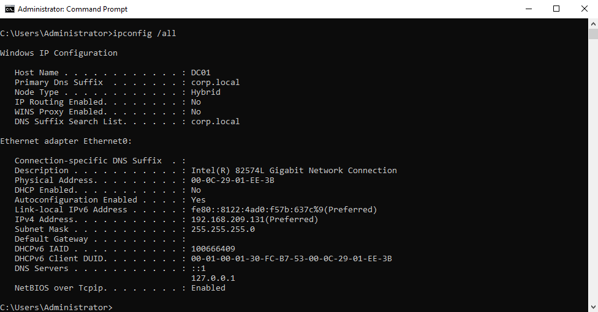
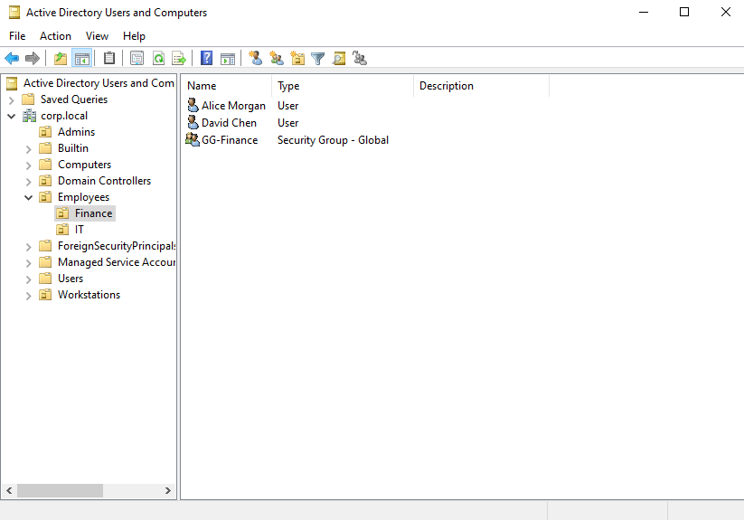
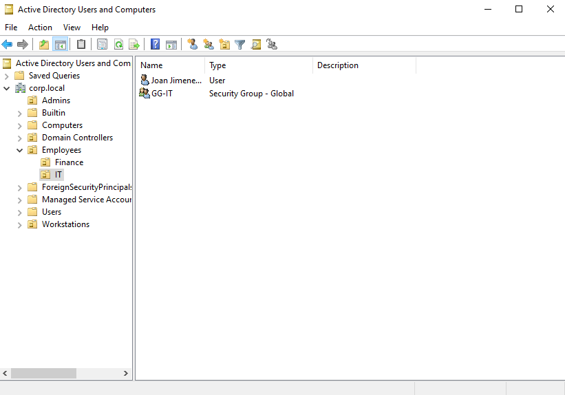
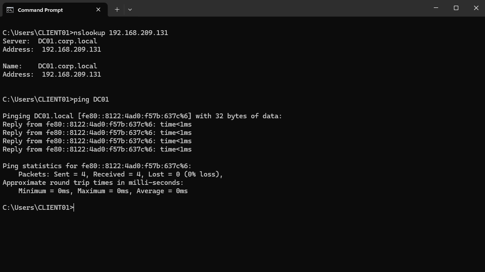
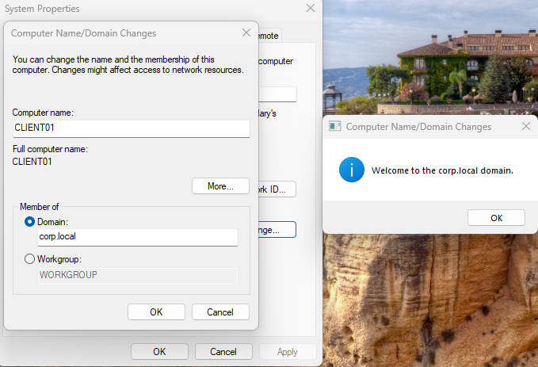
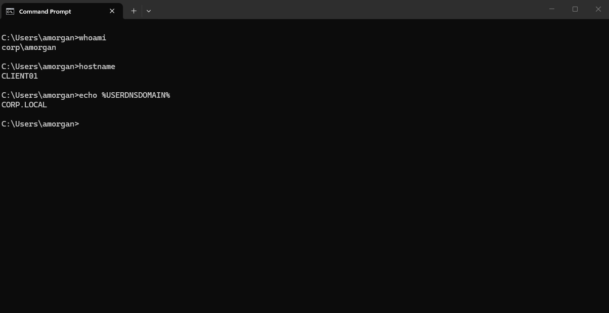
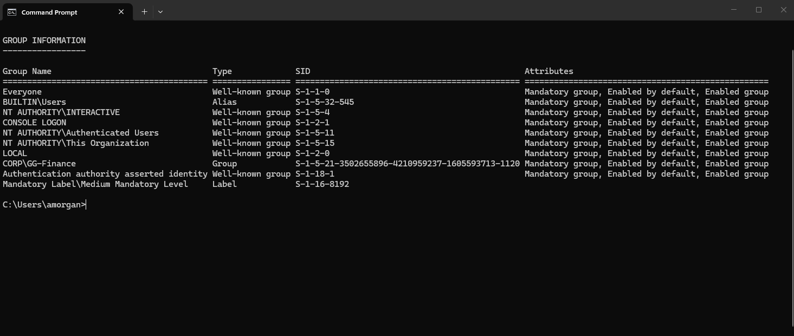

# Active Directory & DNS

Configured Windows Server 2022 as the `DC01` domain controller for `corp.local`.

Created organizational units, domain users, and security groups for Finance and IT.

## Domain Controller Configuration

## Finance OU

## IT OU

## DNS & Client Connectivity

Configured CLIENT01 to use DC01 for DNS and verified connectivity.

## Domain Join

Joined CLIENT01 to the `corp.local` domain.

## Domain Authentication

Verified domain authentication from CLIENT01.

## Security Group Membership

Verified the Finance user's `GG-Finance` group membership.

