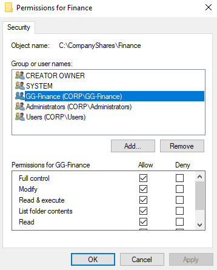
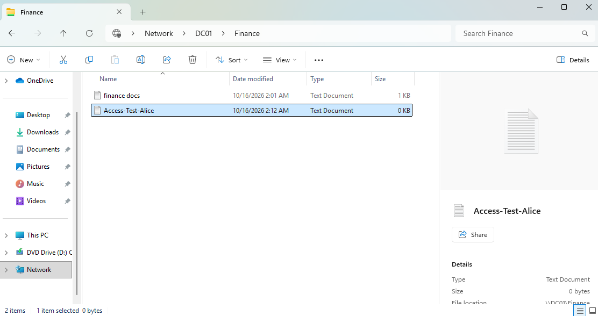
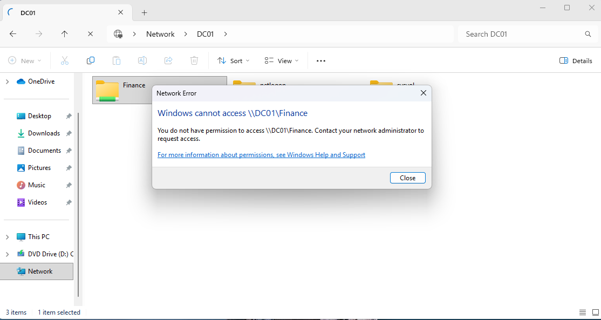

# File Sharing & Access Control

Created an SMB Finance share on DC01 and controlled access through the `GG-Finance` security group.

## Finance Permissions

Configured permissions for members of `GG-Finance`.

## Authorized Access

Verified that a Finance user could access and write to the share.

## Unauthorized Access

Verified that an IT user was denied access to the Finance share.

