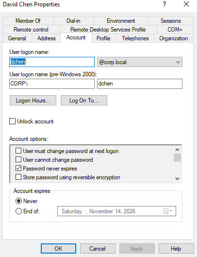
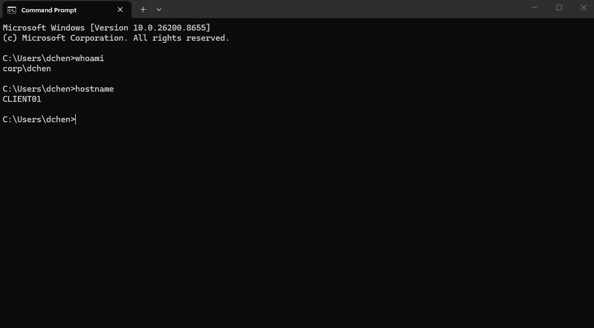

# Account Lockout Troubleshooting

Tested the account lockout policy by triggering a lockout for a domain user.

## Account Lockout

Verified the locked account through Active Directory Users and Computers.

## Account Recovery

Unlocked the account through Active Directory and verified successful authentication on CLIENT01.

